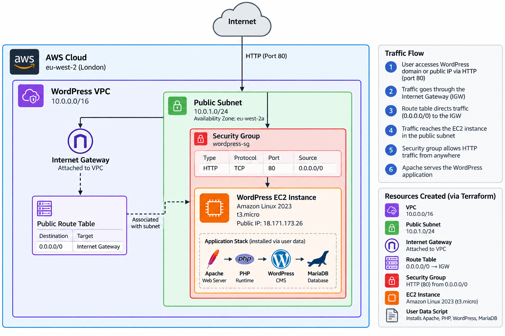
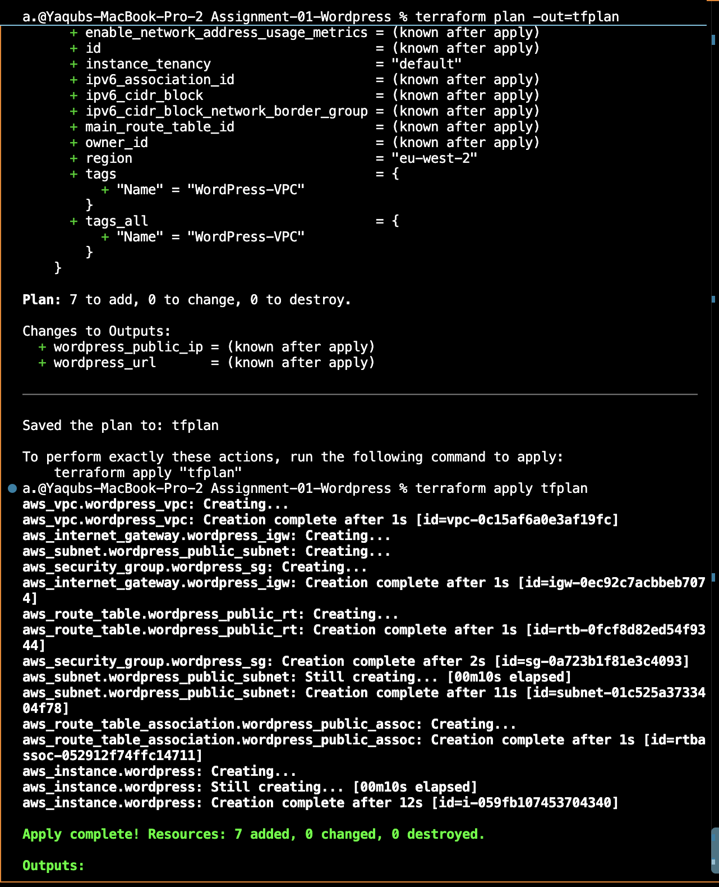
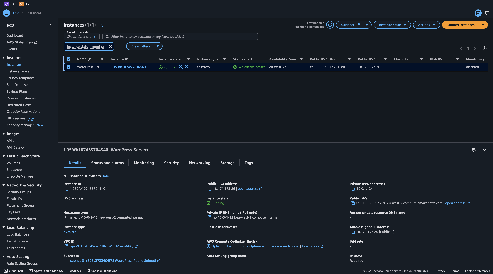
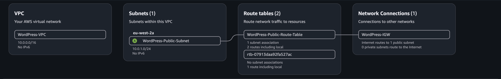
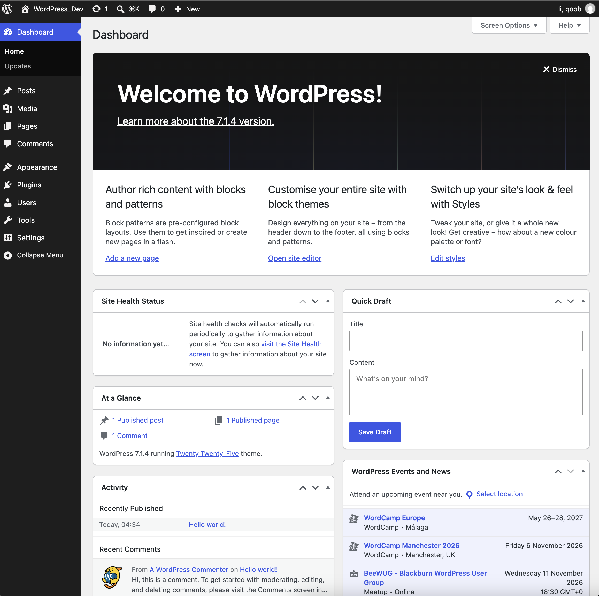

# Assignment 1 — WordPress Deployment Using Terraform

## 📌 Project Overview

This project demonstrates how to deploy a WordPress application on AWS using **Terraform Infrastructure as Code (IaC)**.

The objective was to automate the provisioning of AWS infrastructure and the installation of WordPress without manually creating resources through the AWS Management Console.

Using Terraform, I provisioned a custom VPC, public subnet, internet gateway, route table, security group, and EC2 instance.

A Bash user data script automatically installed and configured Apache, PHP, MariaDB, and WordPress.

The deployment was successful, and the WordPress installation wizard was accessible through the EC2 instance's public IP address.

> **Note:** This is a learning project rather than a production-ready deployment. It uses HTTP and hosts the database locally on the EC2 instance.

---

## 🛠️ Technologies Used

| Technology | Purpose |
|------------|---------|
| Terraform | Infrastructure provisioning and automation |
| AWS EC2 | Hosting the WordPress application |
| AWS VPC | Creating an isolated virtual network |
| AWS Subnet | Providing a public network for EC2 |
| Internet Gateway | Enabling internet connectivity |
| Route Table | Directing traffic to the internet gateway |
| Security Groups | Controlling inbound and outbound traffic |
| Amazon Linux 2023 | EC2 operating system |
| Apache | Web server |
| PHP | WordPress application runtime |
| MariaDB | WordPress database |
| Bash | Automating software installation and configuration |
| Git & GitHub | Version control and project documentation |

---

## 🏗️ Infrastructure Architecture

The infrastructure consists of seven Terraform-managed AWS resources.

### 1. Virtual Private Cloud (VPC)

A custom VPC was created with the following CIDR block:

`10.0.0.0/16`

This provides an isolated networking environment for the application.

### 2. Public Subnet

A public subnet was created within the VPC:

`10.0.1.0/24`

The EC2 instance is deployed into this subnet.

### 3. Internet Gateway

An internet gateway was attached to the VPC to enable communication with the internet.

### 4. Route Table

A public route table was configured with the following default route:

`0.0.0.0/0 → Internet Gateway`

This allows resources in the associated public subnet to access the internet.

### 5. Route Table Association

The public subnet was associated with the public route table.

### 6. Security Group

A security group was configured to permit:

- Inbound HTTP traffic on port 80.
- Outbound traffic to the internet.

This allows users to access the WordPress installation through a web browser.

### 7. EC2 Instance

An Amazon Linux 2023 EC2 instance was deployed using the `t3.micro` instance type.

The instance uses a Bash user data script to automatically install and configure the WordPress application.

### Architecture Diagram



---

## 📂 Project Structure

```text
Assignment-01-WordPress/
│
├── main.tf
│
├── variables.tf
│
├── outputs.tf
│
├── user_data.sh
│
├── .terraform.lock.hcl
│
├── README.md
│
└── screenshots/
    │
    ├── 01-terraform-deployment.png
    │
    ├── 02-ec2-instance.png
    │
    ├── 03-vpc-resource-map.png
    │
    ├── 04-wordpress-running.png
    │
    └── 05-architecture.png
```

### File Descriptions

**main.tf**

Defines the AWS provider, networking infrastructure, security group, and EC2 instance.

**variables.tf**

Defines configurable input variables, including the EC2 instance type.

**outputs.tf**

Displays useful information after deployment, including the EC2 public IP address and WordPress URL.

**user_data.sh**

A Bash script executed during EC2 initialization to install and configure the WordPress application.

**.terraform.lock.hcl**

Records the selected Terraform provider versions and checksums to support reproducible deployments.

**README.md**

Documents the project architecture, deployment process, troubleshooting, and lessons learned.

**screenshots/**

Contains evidence of the infrastructure deployment and running application.

---

## ⚙️ Deployment Instructions

### Prerequisites

Before deploying this project, ensure you have:

1. An AWS account.
2. Terraform installed.
3. AWS CLI installed and configured.
4. IAM permissions to provision the required AWS resources.
5. Git installed.

### Step 1 — Clone the Repository

Clone the repository containing this project.

Navigate into the assignment directory:

```bash
cd Assignment-01-WordPress
```

### Step 2 — Initialise Terraform

Run:

```bash
terraform init
```

This initialises the working directory and downloads the required AWS provider.

### Step 3 — Format the Configuration

Run:

```bash
terraform fmt
```

This formats the Terraform configuration files.

### Step 4 — Validate the Configuration

Run:

```bash
terraform validate
```

This checks whether the Terraform configuration is syntactically valid and internally consistent.

### Step 5 — Preview the Infrastructure

Run:

```bash
terraform plan
```

Terraform generates an execution plan showing the infrastructure it intends to create.

For this assignment, the initial deployment plan contained seven resources.

### Step 6 — Deploy the Infrastructure

Run:

```bash
terraform apply
```

Review the execution plan and enter:

```text
yes
```

Terraform then provisions the AWS infrastructure.

### Step 7 — Retrieve the WordPress URL

After deployment, run:

```bash
terraform output wordpress_url
```

Terraform displays the URL associated with the deployed EC2 instance.

Open the URL in a browser.

Allow a few minutes for the EC2 user data script to complete the WordPress installation.

Once the installation finishes, the WordPress setup wizard should appear.

---

## 📸 Deployment Screenshots

### 1. Terraform Deployment

The following screenshot demonstrates the successful execution of Terraform and the infrastructure deployment.



### 2. EC2 Instance

The following screenshot shows the EC2 instance provisioned through Terraform.



### 3. VPC Resource Map

The following screenshot displays the AWS VPC networking infrastructure created for this deployment.



### 4. WordPress Application

The following screenshot demonstrates that WordPress was successfully installed and its setup wizard was accessible through the EC2 instance's public IP address.



---

## 🧠 Challenges & Lessons Learned

Throughout this assignment, I encountered several challenges that improved my understanding of Terraform, AWS, and infrastructure troubleshooting.

### Challenge 1 — Terraform Installation

**Problem:**

When initially attempting to execute Terraform commands, my terminal did not recognise the `terraform` command.

**Solution:**

I installed Terraform locally and verified that the CLI was accessible.

**What I learned:**

Before working with Infrastructure as Code, it is important to ensure that the local development environment is configured correctly.

### Challenge 2 — AWS IAM Permissions

**Problem:**

During the initial Terraform plan, AWS returned an authorisation error for:

```text
ec2:DescribeImages
```

Terraform required this permission to retrieve information about the Amazon Linux AMI.

**Solution:**

I identified the missing IAM permission and updated the IAM user's access.

**What I learned:**

Terraform interacts with AWS through API calls, and each operation requires the appropriate IAM permissions.

### Challenge 3 — EC2 Infrastructure Permissions

**Problem:**

After resolving the initial permission issue, Terraform encountered another authorisation error:

```text
ec2:CreateVpc
```

The IAM user did not have sufficient permissions to provision the VPC.

**Solution:**

I updated the IAM permissions to allow the required infrastructure operations.

For this learning exercise, broader EC2 permissions were temporarily granted to complete the deployment.

**What I learned:**

AWS IAM policies determine which infrastructure operations Terraform can perform.

I also learned the importance of applying the principle of least privilege rather than retaining unnecessarily broad permissions.

### Challenge 4 — Terraform Detecting No Changes

**Problem:**

At one stage, Terraform reported that there were no infrastructure changes to apply, despite modifications to my configuration.

**Solution:**

I discovered that my configuration changes had not been saved in VS Code.

After saving the files, Terraform successfully detected the intended infrastructure changes.

**What I learned:**

Terraform evaluates the configuration files saved on disk, not unsaved changes within an editor.

### Challenge 5 — Git Repository Organisation

**Problem:**

While preparing the project for GitHub, I needed to ensure that generated Terraform files and sensitive infrastructure information were not accidentally committed.

**Solution:**

I configured a repository-level `.gitignore` file to exclude Terraform state files, saved execution plans, and local provider files.

I also organised the deployment screenshots and documentation into a consistent project structure.

**What I learned:**

A professional Infrastructure as Code repository should be reproducible, clearly documented, and structured to avoid exposing sensitive information.

---

## 🔐 Security Considerations

This assignment was designed for learning and demonstration purposes.

For a production deployment, several additional security measures would be necessary.

### HTTPS

The application currently uses HTTP on port 80.

A production application should use HTTPS with a valid TLS certificate.

### Database Security

MariaDB runs locally on the EC2 instance.

A production architecture could use Amazon RDS to provide a managed database with additional backup, availability, and security capabilities.

### IAM Permissions

IAM permissions should follow the principle of least privilege.

Broad permissions temporarily granted for testing should be removed when they are no longer required.

### Secrets Management

Sensitive credentials should not be stored in Git repositories.

The bootstrap script generates a database password on the EC2 instance rather than hardcoding a fixed password into the Terraform configuration.

For production environments, a dedicated secrets management solution would be preferable.

### Terraform State

Terraform state files may contain sensitive infrastructure information.

They should not be committed to public Git repositories.

Production environments should use a secure remote backend with appropriate access controls and state locking.

---

## 🧹 Infrastructure Cleanup

To prevent unnecessary AWS charges, the infrastructure can be destroyed when it is no longer required.

Run:

```bash
terraform destroy
```

Review the proposed changes and confirm the destruction.

Terraform will remove the AWS resources managed by this configuration.

**Important:** Keep the local Terraform state file until the destruction has completed successfully.

---

## 🎯 Key Takeaways

Completing this assignment strengthened my understanding of:

- Infrastructure as Code using Terraform.
- AWS networking fundamentals.
- Provisioning EC2 instances programmatically.
- Configuring security groups and routing.
- Automating application installation using Bash.
- Troubleshooting AWS IAM permission errors.
- Understanding Terraform execution plans.
- Managing Terraform state securely.
- Documenting infrastructure projects for GitHub.

The biggest takeaway was understanding how Terraform can automate the deployment of interconnected AWS resources through a single configuration.

---

## ✅ Project Status

**Completed — Infrastructure successfully deployed and WordPress installation verified.**

All seven Terraform-managed resources were provisioned successfully.

The WordPress installation wizard was accessible through the EC2 instance's public IP address.

Deployment screenshots and an infrastructure architecture diagram have been included as evidence.

The infrastructure can be destroyed after verification to avoid unnecessary AWS charges.