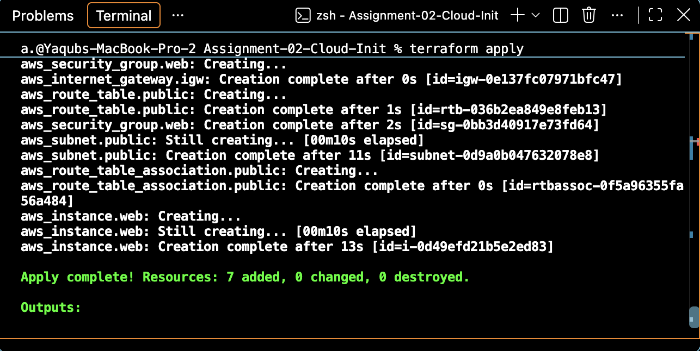
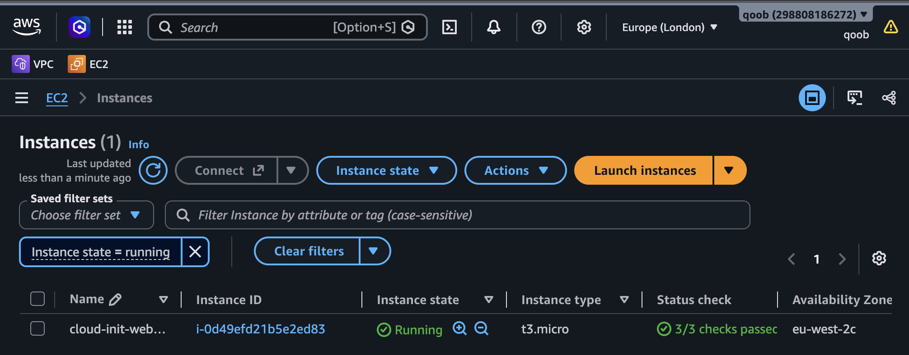
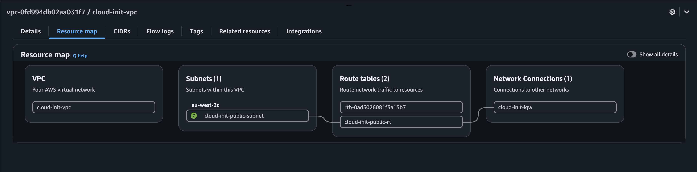
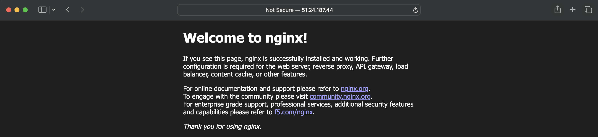
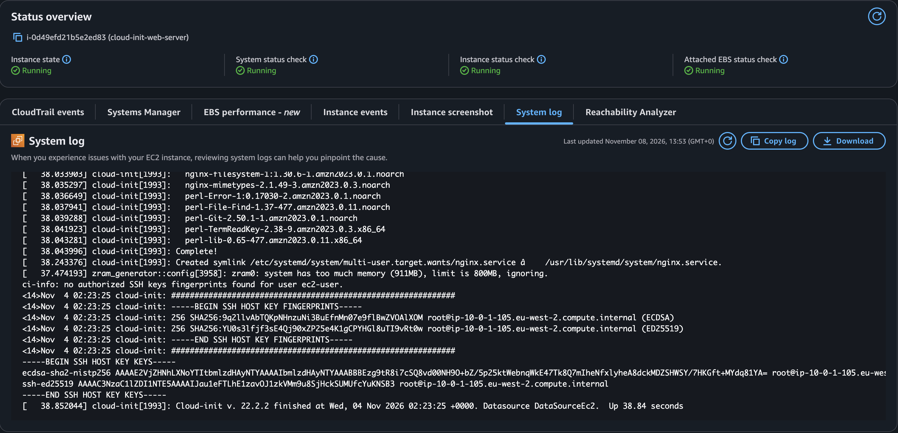

# Assignment 2 — EC2 Deployment with Cloud-Init

## 📌 Project Overview

This project demonstrates how to automate the deployment and configuration of an AWS EC2 instance using **Terraform and cloud-init**.

Terraform provisions the AWS networking infrastructure and EC2 instance, while cloud-init automatically installs and configures an NGINX web server during the instance's initial boot.

The objective is to deploy a fully configured web server without manually connecting to the instance through SSH.

## 🛠️ Technologies Used

- Terraform — Infrastructure as Code
- AWS EC2 — Compute
- AWS VPC, Subnet, Internet Gateway and Route Table — Networking
- AWS Security Groups — Network access control
- Amazon Linux 2023 — Operating system
- Cloud-init — Automated instance configuration
- NGINX — Web server
- YAML — Cloud-init configuration
- Git and GitHub — Version control

## 🏗️ Infrastructure Architecture

Terraform provisions seven AWS resources:

1. VPC (`10.0.0.0/16`)
2. Public subnet (`10.0.1.0/24`)
3. Internet gateway
4. Public route table
5. Route table association
6. Security group allowing HTTP traffic on port 80
7. EC2 instance running Amazon Linux 2023

The EC2 instance receives the cloud-init configuration through Terraform's `user_data` argument.

### Deployment Workflow

1. Terraform provisions the AWS infrastructure.
2. EC2 launches with the cloud-init YAML supplied as user data.
3. Cloud-init refreshes package information.
4. Cloud-init installs NGINX and Git.
5. Cloud-init creates a custom `index.html` file.
6. Cloud-init enables and starts NGINX.
7. The webpage becomes accessible through the EC2 public IP address.

## 📂 Project Structure

```text
Assignment-02-Cloud-Init/
├── main.tf
├── variables.tf
├── outputs.tf
├── cloud-init.yaml
├── README.md
└── screenshots/
    ├── 01-terraform-deployment.png
    ├── 02-ec2-instance.png
    ├── 03-vpc-resource-map.png
    ├── 04-nginx-running.png
    └── 05-cloud-init-completion.png
```

## ⚙️ Terraform and Cloud-Init Integration

The following Terraform configuration reads the cloud-init YAML file and passes its contents to EC2:

```hcl
user_data = file("${path.module}/cloud-init.yaml")
```

- `file()` reads the YAML file.
- `path.module` identifies the directory containing the Terraform module.
- `user_data` passes the configuration to EC2.
- Cloud-init processes the configuration during instance initialisation.

### Cloud-Init Configuration

```yaml
#cloud-config

package_update: true

packages:
  - nginx
  - git

write_files:
  - path: /usr/share/nginx/html/index.html
    permissions: '0644'
    content: |
      <!DOCTYPE html>
      <html>
        <head>
          <title>DevOps Project</title>
        </head>
        <body>
          <h1>Welcome to my DevOps project!</h1>
          <p>Deployed using Terraform and Cloud-Init.</p>
        </body>
      </html>

runcmd:
  - systemctl enable nginx
  - systemctl start nginx
```

The configuration installs the required software, creates the webpage and starts NGINX automatically.

## 🚀 Deployment Instructions

### Prerequisites

- Terraform installed
- AWS account
- AWS credentials configured
- IAM permissions to provision the required resources

### Deploy

From the assignment directory:

```bash
terraform init
terraform fmt
terraform validate
terraform plan
terraform apply
```

Review the Terraform execution plan before approving deployment.

### Retrieve the Website URL

```bash
terraform output website_url
```

Open the returned URL in a browser.

Cloud-init may continue running briefly after Terraform finishes provisioning the instance.

## 📸 Deployment Evidence

### 1. Terraform Deployment



### 2. EC2 Instance



### 3. VPC Resource Map



### 4. NGINX Webpage



### 5. Cloud-Init System Log



## 🔍 Verification

The deployment was verified by:

- Confirming Terraform successfully created the infrastructure.
- Checking that the EC2 instance was running.
- Accessing the custom NGINX webpage through the public IP address.
- Reviewing the EC2 system log for cloud-init completion.

A running webpage demonstrates that NGINX is serving the configured HTML content.

Cloud-init completion messages provide additional evidence that the initialisation process finished.

## 🧠 Lessons Learned

This assignment strengthened my understanding of:

- Passing cloud-init configuration to EC2 through Terraform.
- Writing YAML configuration files.
- Installing packages automatically during instance initialisation.
- Creating files with cloud-init's `write_files` module.
- Managing Linux services using `systemctl`.
- Understanding the difference between infrastructure provisioning and instance configuration.
- Verifying automated deployments using AWS console logs.

## 🔐 Security Considerations

This is a learning deployment rather than a production-ready web application.

A production deployment should consider HTTPS, tighter network access controls, monitoring, patch management and least-privilege IAM permissions.

Terraform state files and credentials must not be committed to GitHub.

## 🧹 Infrastructure Cleanup

To avoid unnecessary AWS charges:

```bash
terraform destroy
```

Review the destruction plan before confirming.

## ✅ Project Status

**Completed — EC2 deployed using Terraform, NGINX configured automatically through cloud-init, and the webpage verified in a browser.**
